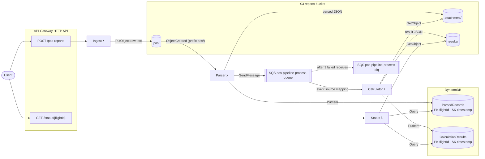

# POS Report Pipeline

A serverless, event-driven pipeline on AWS that ingests aircraft position (POS) reports over HTTP, stores the raw and parsed data, and works out each flight's remaining flight time, estimated fuel at arrival, and a low-fuel warning in the background. Clients submit a report with `POST /pos-reports`, get a `flightId` back straight away, and poll `GET /status/{flightId}` for the result. The Lambda handlers are written in C# (.NET 8). All infrastructure is defined in AWS CDK (TypeScript): nothing is created or changed by hand in the console. The same stack deploys to real AWS and to the free, LocalStack-compatible emulator [Floci](https://github.com/floci-io/floci).

## Table of contents

1. [Architecture](#architecture)
2. [POS message format](#pos-message-format)
3. [API reference](#api-reference)
4. [Data model](#data-model)
5. [Project structure](#project-structure)
6. [Prerequisites](#prerequisites)
7. [Run and test locally](#run-and-test-locally)
8. [Deploy to AWS](#deploy-to-aws)
9. [Decisions, failures, and assumptions](#decisions-failures-and-assumptions)

---


## Architecture


Architecture diagram (Mermaid source)




**How the pieces fit**

1. **Ingest** checks the raw text, builds the `flightId`, writes the message to `pos/` and returns **202 RECEIVED**. It does no other processing.
2. The S3 `ObjectCreated` notification, filtered to the `pos/` prefix, triggers **Parser**. Parser decodes the message and then, in order, writes the parsed JSON to `attachment/`, puts a row in `ParsedRecords` and sends a message to the processing queue.
3. **Calculator** reads the parsed JSON, looks up the destination airport and runs the haversine distance, time and fuel calculations. It writes the result JSON to `results/` and puts a row in `CalculationResults`. If a message fails, only that message is retried. After 3 receives it moves to the DLQ.
4. **Status** returns the latest calculation for that `flightId`, or an earlier state while the pipeline is still working. See [GET /status](#get-statusflightid).


| Component            | Resource                           | Configuration                                                                         |
| -------------------- | ---------------------------------- | ------------------------------------------------------------------------------------- |
| HTTP API             | `pos-reports-api` (API Gateway v2) | `POST /pos-reports`, `GET /status/{flightId}`. CORS for `GET`/`POST`                  |
| Ingest Lambda        | `pos-pipeline-ingest`              | .NET 8, 512 MB, 30 s                                                                  |
| Parser Lambda        | `pos-pipeline-parser`              | .NET 8, 512 MB, 60 s. S3 `ObjectCreated` on `pos/` only                               |
| Calculator Lambda    | `pos-pipeline-calculator`          | .NET 8, 512 MB, 60 s. SQS batch size 10, 5 s window, `reportBatchItemFailures`        |
| Status Lambda        | `pos-pipeline-status`              | .NET 8, 512 MB, 30 s                                                                  |
| Reports bucket       | S3 (name generated by CDK)         | SSE-S3, public access blocked, prefixes `pos/`, `attachment/`, `results/`             |
| `ParsedRecords`      | DynamoDB                           | PK `flightId`, SK `timestamp`, on-demand                                              |
| `CalculationResults` | DynamoDB                           | PK `flightId`, SK `timestamp`, on-demand                                              |
| Processing queue     | `pos-pipeline-process-queue`       | Visibility 180 s (3 × Calculator timeout), long poll 20 s, `maxReceiveCount: 3` → DLQ |
| Dead-letter queue    | `pos-pipeline-process-dlq`         | 14-day retention                                                                      |


**Stack outputs:** `ApiUrl`, `BucketName`, `ParsedRecordsTableName`, `CalculationResultsTableName`, `ProcessQueueUrl`, `ProcessDlqUrl`.

---


## POS message format

```
POS/{IATA}{flightNumber}.FR {departure}/TO {destination}/{ddHHmm}/{lat}{lon}/{groundSpeedKnots}/{fuelOnBoardKg}/{fuelFlowKgPerHour}
```

```
POS/UL204.FR RGN/TO BKK/041205/N1642.3E09612.5/450/12500/2800
```


| Segment                               | Example           | Meaning and parsing rule                                                                                                                                                                                         |
| ------------------------------------- | ----------------- | ---------------------------------------------------------------------------------------------------------------------------------------------------------------------------------------------------------------- |
| `POS`                                 | `POS`             | Literal prefix (not case-sensitive)                                                                                                                                                                              |
| `{IATA}{flightNumber}.FR {departure}` | `UL204.FR RGN`    | Airline code = characters before the first digit (`UL`). Flight number = the rest (`204`). Departure airport follows `.FR` (`RGN`)                                                                               |
| `TO {destination}`                    | `TO BKK`          | Destination airport (`BKK`)                                                                                                                                                                                      |
| `{ddHHmm}`                            | `041205`          | Day 04, 12:05 UTC. Year and month come from the time the request was received (UTC)                                                                                                                              |
| `{lat}{lon}`                          | `N1642.3E09612.5` | Latitude: `N`/`S` + **2-digit** degrees + decimal minutes. Longitude: `E`/`W` + **3-digit** degrees + decimal minutes. Decimal degrees = degrees + minutes / 60. `S` and `W` are negative. Here: 16.705, 96.2083 |
| `{groundSpeedKnots}`                  | `450`             | Ground speed (kt), integer                                                                                                                                                                                       |
| `{fuelOnBoardKg}`                     | `12500`           | Fuel on board (kg), integer                                                                                                                                                                                      |
| `{fuelFlowKgPerHour}`                 | `2800`            | Fuel flow (kg/h), integer                                                                                                                                                                                        |


### flightId

```
{IATA}{flightNumber}{yyyyMMdd}{departure}{destination}      (no separators)
```

`yyyy` and `MM` are the UTC year and month when the report was received. `dd` is the day in the message. A report sent in October 2026 with day `04` gives `UL20420261004RGNBKK`.

Parser uses the `flightId` and ingest timestamp stored in S3 object metadata (written by Ingest), so the date matches the original POST time rather than when the S3 event is delivered. That keeps the id stable near a month boundary.

The raw object key is `pos/{flightId}-{requestUtc}`. For a request at `2026-10-04T15:12:30.123Z` that is `pos/UL20420261004RGNBKK-2026-10-04T15:12:30.123Z`.

### Calculation


| Step             | Formula                                                          | Gold example (RGN → BKK)            |
| ---------------- | ---------------------------------------------------------------- | ----------------------------------- |
| Distance         | Haversine, `EarthRadiusNauticalMiles = 3440.065`                 | ≈ 319.5 NM to BKK (13.681, 100.747) |
| Remaining time   | `distance / groundSpeed`, minutes rounded to the nearest integer | **43 min**                          |
| Fuel at arrival  | `fuelOnBoard − fuelFlow × hours`, rounded to the nearest kg      | **10512 kg**                        |
| Low-fuel warning | `true` when fuel at arrival is negative                          | `false`                             |


---


## API reference

Responses are JSON (`Content-Type: application/json`). Field names are PascalCase, the default for `System.Text.Json`.

### `POST /pos-reports`

The body is the raw POS text.

```bash
curl -i -X POST "$API_URL/pos-reports" \
  -H "Content-Type: text/plain" \
  --data 'POS/UL204.FR RGN/TO BKK/041205/N1642.3E09612.5/450/12500/2800'
```

**202 Accepted**

```json
{ "FlightId": "UL20420261004RGNBKK", "Status": "RECEIVED", "Timestamp": "<request time, UTC>" }
```


| Status | When                                                                                                  | Body                                          |
| ------ | ----------------------------------------------------------------------------------------------------- | --------------------------------------------- |
| `202`  | Message accepted and stored in `pos/`                                                                 | `FlightId`, `Status: "RECEIVED"`, `Timestamp` |
| `400`  | Empty body, missing `POS/` prefix, too few `/`-separated segments, or a segment that cannot be parsed | `{ "error": "<reason>" }`                     |
| `500`  | Unexpected failure (for example the S3 write)                                                         | `{ "error": "Internal server error" }`        |


Ingest runs the full parser before it writes anything. A malformed message is rejected with 400 and never enters the pipeline.

### `GET /status/{flightId}`

```bash
curl -i "$API_URL/status/UL20420261004RGNBKK"
```

**200 OK, calculation complete**

```json
{
  "FlightId": "UL20420261004RGNBKK",
  "Status": "COMPLETE",
  "Timestamp": "<calculation time, UTC>",
  "RemainingFlightTimeMinutes": 43,
  "EstimatedFuelAtArrivalKg": 10512,
  "LowFuelWarning": false
}
```


| Status             | When                                                                              | Body                                                                           |
| ------------------ | --------------------------------------------------------------------------------- | ------------------------------------------------------------------------------ |
| `200` `COMPLETE`   | A `CalculationResults` row exists and no newer parsed record is pending           | The latest calculation, loaded from the `results/` object it points to         |
| `200` `PROCESSING` | Parsed but not yet calculated, or a newer report is parsed but not yet calculated | `FlightId`, `Status: "PROCESSING"`, `Timestamp`. Calculation fields are `null` |
| `404`              | Nothing recorded for this `flightId` yet                                          | `{ "error": "No records found for flight <flightId>" }`                        |
| `500`              | Unexpected failure                                                                | `{ "error": "Internal server error" }`                                         |


The pipeline is asynchronous. A `GET` sent right after a `POST` can return `404` or `PROCESSING`. That lag is normal. On a warm stack the status reaches `COMPLETE` within seconds.

### Example session

```bash
# Normal flight
curl -s -X POST "$API_URL/pos-reports" -H "Content-Type: text/plain" \
  --data 'POS/UL204.FR RGN/TO BKK/041205/N1642.3E09612.5/450/12500/2800'
sleep 5
curl -s "$API_URL/status/UL20420261004RGNBKK"
# -> COMPLETE, RemainingFlightTimeMinutes 43, EstimatedFuelAtArrivalKg 10512, LowFuelWarning false

# Low fuel (1500 kg on board)
curl -s -X POST "$API_URL/pos-reports" -H "Content-Type: text/plain" \
  --data 'POS/UL205.FR RGN/TO BKK/041205/N1642.3E09612.5/450/1500/2800'
sleep 5
curl -s "$API_URL/status/UL20520261004RGNBKK"
# -> LowFuelWarning true

# Invalid body -> 400
curl -i -X POST "$API_URL/pos-reports" -H "Content-Type: text/plain" --data 'hola'

# Unknown flight -> 404
curl -i "$API_URL/status/NOPE123"
```

The date part of a `flightId` depends on the month you send the report in. Use the `FlightId` from the `POST` response.

---


## Data model


### S3 (one bucket)


| Prefix        | Written by | Key                                                                 | Content                                                                                                                                                                                                         |
| ------------- | ---------- | ------------------------------------------------------------------- | --------------------------------------------------------------------------------------------------------------------------------------------------------------------------------------------------------------- |
| `pos/`        | Ingest     | `pos/{flightId}-{requestUtc:yyyy-MM-ddTHH:mm:ss.fffZ}`               | Raw POS text. Metadata: `flightid`, `ingest-timestamp`                                                                                                                                                          |
| `attachment/` | Parser     | `attachment/{flightId}-{posTimestamp:yyyy-MM-ddTHH:mm:ssZ}.json` | Parsed `PosReport`: `FlightId`, `IataCode`, `FlightNumber`, `Departure`, `Destination`, `Timestamp` (POS time), `Latitude`, `Longitude`, `GroundSpeedKnots`, `FuelOnBoardKg`, `FuelFlowKgPerHour`, `RawMessage` |
| `results/`    | Calculator | `results/{flightId}-{calcUtc:yyyy-MM-ddTHH:mm:ss.fffZ}.json`         | `CalculationResult`: `FlightId`, `Timestamp` (when the calculation ran), `DistanceNauticalMiles`, `RemainingFlightTimeMinutes`, `EstimatedFuelAtArrivalKg`, `LowFuelWarning`                                    |


Only `pos/` triggers Parser. Writes to `attachment/` and `results/` do not invoke it again.

### DynamoDB

Both tables use `flightId` (S) as the partition key and an ISO-8601 `timestamp` (S) as the sort key. Rows store an `attachment` pointer to S3, not the payload. Status reads the newest row with `Query(flightId, ScanIndexForward=false, Limit=1)`.


| Table                | Sort key         | Other attributes                                  |
| -------------------- | ---------------- | ------------------------------------------------- |
| `ParsedRecords`      | POS message time | `attachment` (S3 key), `departure`, `destination` |
| `CalculationResults` | Calculation time | `attachment` (S3 key of the `results/` object)    |

**Timestamp format:** All timestamps in S3 keys and DynamoDB are ISO-8601 UTC. The `pos/` and `results/` keys include milliseconds (e.g. `2026-09-04T15:12:30.123Z`), while `attachment/` keys use the POS message timestamp without milliseconds (e.g. `2026-09-04T12:05:00Z`).


### SQS message (Parser → Calculator)

```json
{
  "flightId": "UL20420261004RGNBKK",
  "attachmentKey": "attachment/UL20420261004RGNBKK-2026-10-04T12:05:00Z.json",
  "timestamp": "2026-10-04T12:05:00.0000000Z"
}
```

CDK sets `BUCKET_NAME`, the table names and `PROCESS_QUEUE_URL` on the functions that need them. Each handler throws at startup if one of its variables is missing.

---


## Project structure

```
.
├── README.md
├── ARCHITECTURE.md
├── cdk/                                # AWS CDK app (TypeScript)
│   ├── bin/app.ts
│   ├── lib/pos-pipeline-stack.ts       # Resources, IAM, routes, outputs
│   ├── cdk.json
│   └── package.json
├── scripts/
│   ├── sample-pos.txt
│   └── example-commands.sh
└── src/
    ├── PosPipeline.sln
    ├── PosPipeline.Shared/             # Models, parser, flightId, haversine, airports
    ├── PosPipeline.Ingest/             # POST /pos-reports
    ├── PosPipeline.Parser/             # S3 pos/ → attachment/ + ParsedRecords + SQS
    ├── PosPipeline.Calculator/         # SQS → results/ + CalculationResults
    ├── PosPipeline.Status/             # GET /status/{flightId}
    └── PosPipeline.Tests/
```

---


## Prerequisites


| Tool     | Version                                      | Used for                                                       |
| -------- | -------------------------------------------- | -------------------------------------------------------------- |
| .NET SDK | 8.0                                          | Building and testing the handlers                              |
| Node.js  | 18+                                          | CDK app                                                        |
| Docker   | Recent, must be running                      | Lambda bundling (`public.ecr.aws/sam/build-dotnet8`) and Floci |
| AWS CLI  | v2                                           | Credentials and inspecting resources                           |
| AWS CDK  | v2 (`npm install` in `cdk/`, then `npx cdk`) | Synth, deploy and destroy                                      |


---


## Run and test locally

Run the unit tests before deploying. They cover the parsing and calculation logic and do not need AWS.

```bash
cd src && dotnet test          # 27 xUnit tests
cd cdk && npm test             # 17 CDK assertion tests
```


| Suite                     | What it checks                                                                                                                                                          |
| ------------------------- | ----------------------------------------------------------------------------------------------------------------------------------------------------------------------- |
| `PosParser` (10)          | Gold latitude 16.705 and longitude 96.2083, every field, `S`/`W` signs, invalid and truncated messages                                                                  |
| `FlightIdBuilder` (3)     | Id format, year and month taken from the request, multi-character airline codes                                                                                         |
| `HaversineCalculator` (8) | Gold distance (≈319 NM), flight time (43 min), fuel at arrival, negative fuel → warning, zero ground speed rejected                                                     |
| `AirportLookup` (6)       | Known and unknown codes, case-insensitive lookup                                                                                                                        |
| CDK (17)                  | Throttle defaults, S3 encryption and blocked public access, DLQ `maxReceiveCount: 3`, DynamoDB keys, least-privilege IAM, 14-day log retention, `dotnet8`, `local=true` |


GitHub Actions runs both suites, plus `cdk synth`, on every push and pull request to `main`.

### Floci

[Floci](https://github.com/floci-io/floci) emulates the AWS APIs on port `4566` and runs Lambda in Docker. The same CDK app deploys to it with one context flag.

**1. Start Floci.** The Docker socket is mounted so it can start Lambda containers.

```bash
docker run -d --name floci -p 4566:4566 \
  -v /var/run/docker.sock:/var/run/docker.sock \
  floci/floci:latest
```

**2. Install CDK dependencies and the** `cdklocal` **wrapper.**

```bash
cd cdk
npm install
npm install --no-save aws-cdk-local
```

**3. Use dummy credentials and bootstrap the emulated account.**

```bash
export AWS_ACCESS_KEY_ID=test
export AWS_SECRET_ACCESS_KEY=test
export AWS_DEFAULT_REGION=us-east-1

npx cdklocal bootstrap aws://000000000000/us-east-1
```

**4. Deploy with** `local=true`**.**

```bash
npx cdklocal deploy -c local=true --require-approval never --outputs-file /tmp/pos-outputs.json
```

`-c local=true` sets `autoDeleteObjects: false` on the reports bucket. On AWS that flag adds a custom resource which does not deploy reliably on the emulator. Nothing else changes.

**5. Find the API endpoint.** On Floci an HTTP API is served at `http://localhost:4566/restapis/<api-id>/$default/_user_request_`. The id is the `ApiUrl` output, or:

```bash
API_ID=$(aws --endpoint-url http://localhost:4566 apigatewayv2 get-apis \
  --query "Items[?Name=='pos-reports-api'].ApiId" --output text)
API_URL="http://localhost:4566/restapis/${API_ID}/\$default/_user_request_"
```

**6. Smoke test.** Run the [example session](#example-session). Expect `202` then `COMPLETE` (43 min, 10512 kg) for the gold message, `LowFuelWarning: true` for the 1500 kg message, `400` for `hola`, and `404` for `NOPE123`.

**7. Inspect resources (optional).**

```bash
BUCKET=$(jq -r '.PosPipelineStack.BucketName' /tmp/pos-outputs.json)
aws --endpoint-url http://localhost:4566 s3 ls "s3://$BUCKET" --recursive
aws --endpoint-url http://localhost:4566 dynamodb scan --table-name ParsedRecords
aws --endpoint-url http://localhost:4566 dynamodb scan --table-name CalculationResults
```

**Clean up:** `docker rm -f floci`

---


## Deploy to AWS

Docker must be running. Each Lambda is compiled inside `public.ecr.aws/sam/build-dotnet8` with `dotnet publish -c Release --runtime linux-x64 --self-contained false`.

```bash
cd cdk
npm install

# 1. One-time per account and region
npx cdk bootstrap aws://<ACCOUNT_ID>/<REGION>

# 2. Review the changes
npx cdk diff

# 3. Deploy and save the outputs
npx cdk deploy --outputs-file outputs.json
```

`bin/app.ts` takes the account and region from `CDK_DEFAULT_ACCOUNT` and `CDK_DEFAULT_REGION` (your AWS CLI profile). The stack has been deployed to `ap-southeast-7`.

```bash
API_URL=$(jq -r '.PosPipelineStack.ApiUrl' outputs.json)
```

Then run the [example session](#example-session). Logs are in `/aws/lambda/<function-name>`:

```bash
aws logs tail /aws/lambda/pos-pipeline-calculator --follow
```

**Tear down**

```bash
npx cdk destroy
```

The bucket and both tables use `RemovalPolicy.DESTROY`, and the bucket has `autoDeleteObjects`. `destroy` removes the data as well as the resources.

---


## Decisions, failures, and assumptions

**Asynchronous pipeline.** Ingest only validates and writes one S3 object, so the API stays fast and the raw message can always be replayed. SQS between Parser and Calculator adds buffering, retries and back-pressure. The cost is eventual consistency, which `PROCESSING` and a short-lived `404` make visible.

**Failures.** Parser writes the attachment, then DynamoDB, then SQS, and rethrows so a failed invocation is retried. A calculation is queued only after the parsed data is stored. Keys are deterministic, so a retry overwrites the same objects. Calculator returns `SQSBatchResponse` with partial batch failures, so one bad message does not retry the whole batch. The queue visibility timeout (180 s) is three times the function timeout, and `maxReceiveCount: 3` sends the message to a DLQ kept for 14 days. An unknown airport fails the calculation, is retried, then lands on the DLQ with the known codes in the log.

**Two tables, payloads in S3.** `ParsedRecords` and `CalculationResults` keep parse and calculation apart. "Latest for a flight" is one query with `Limit 1`. Rows store S3 pointers, so items stay small. Calculator confirms the parsed row, then loads the JSON from `attachment/`. Status checks `CalculationResults` first and loads `results/` for `COMPLETE`; otherwise it falls back to `ParsedRecords` (`PROCESSING`) or returns 404. Calculation fields are not copied into DynamoDB.

**Least privilege.** Each function has its own role, no AWS managed policies, and no wildcard actions or resources. S3 is scoped by prefix. The notification filter is `pos/` only. Log groups are explicit, retained for 14 days, and log permissions are limited to that function's log group.


| Function   | Allowed                                                                                                                                                |
| ---------- | ------------------------------------------------------------------------------------------------------------------------------------------------------ |
| Ingest     | `PutObject` on `pos/*`                                                                                                                                 |
| Parser     | `GetObject` on `pos/*`, `PutObject` on `attachment/*`, `PutItem` on `ParsedRecords`, `SendMessage` to the processing queue                             |
| Calculator | `GetObject` on `attachment/*`, `PutObject` on `results/*`, `Query` on `ParsedRecords`, `PutItem` on `CalculationResults`, consume the processing queue |
| Status     | `GetObject` on `results/*`, `Query` on both tables                                                                                                     |


CDK's own notification and bucket-cleanup helpers use `AWSLambdaBasicExecutionRole`. They do not handle application data.

**Other choices.** Parsing, `flightId`, haversine and the airport lookup live in `PosPipeline.Shared`, so the four functions and the tests cannot drift. Functions publish with `PublishReadyToRun` on `linux-x64` and 512 MB, which keeps cold starts shorter. Airports in the brief (RGN, BKK, SIN) are a static lookup, plus JFK and LAX for tests. HTTP API is used because it is cheaper and lower latency than REST API, and this service does not need usage plans or request validators. Each function logs one line per important step (the key stored, the flight parsed, the queue send, and a calculation summary of distance, time, fuel and warning) and logs errors with the exception and the S3 key or message id. `RemovalPolicy.DESTROY`, `autoDeleteObjects` on AWS, and point-in-time recovery off are deliberate settings for a short-lived test stack.

**Assumptions**

- The `flightId` date and the POS timestamp use the UTC year and month when the report was received, plus the day from the message. A day that does not exist in that month (for example `31` in a 30-day month) is rejected with 400. A report sent on the 1st about the 30th is dated in the month it was received.
- Remaining time is rounded to the nearest minute and fuel at arrival to the nearest kilogram. The warning is set when that rounded fuel is below zero.
- Distance is great-circle from the reported position straight to the airport. Routing, wind and reserves are out of scope.
- Status returns the most recent calculation for a `flightId`.
- The body is raw `text/plain`, one message per request. All timestamps are UTC.

**Not in this version.** The API has no authorizer: anyone with the URL can call it. A production version would add a JWT or IAM authorizer, restrict CORS from `*` to known origins, retain the bucket and tables, turn on point-in-time recovery, S3 versioning and `enforceSSL`, alarm on DLQ depth and Lambda errors, and add a failure destination for Parser's async invocation. The HTTP API is already throttled at 10 requests/s and a burst of 20 (`-c throttleRate` / `-c throttleBurst` to change it). Throttling limits rate only. It is not authentication.